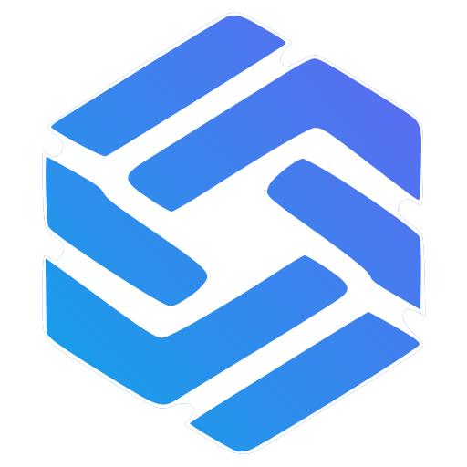

<div align="center">

<a href="https://agentstack.tech">
  <picture>
    <source media="(prefers-color-scheme: dark)" srcset="assets/logo-dark.svg">
    
  </picture>
</a>

# AgentStack MCP

**One MCP server. A whole backend for your AI agent.**

Data, auth & RBAC, payments & wallets, CRM, hosting, RAG, bots, scheduling and automation:
700+ actions behind a single tool, `agentstack.execute`, at `https://agentstack.tech/mcp`.

[](https://www.npmjs.com/package/@agentstack/mcp)
[](https://registry.modelcontextprotocol.io/v0/servers?search=io.github.agentstacktech/agentstack-mcp)
[](LICENSE)
[](https://glama.ai/mcp/servers?query=agentstack)
[](https://github.com/agentstacktech/AgentStack-MCP/actions/workflows/ci.yml)

[Website](https://agentstack.tech) · [MCP docs](https://agentstack.tech/mcp-docs) · [Pricing](https://agentstack.tech/pricing) · [Action catalog](https://agentstack.tech/mcp/actions) · [Status](https://agentstack.tech/mcp/health)

</div>

---

## Why AgentStack

- **One tool, the whole stack.** `agentstack.execute` runs a batch of catalog actions
  (`auth.*`, `projects.*`, `crm.*`, `hosting.*`, `payments.*`, `rag.*` …) in a single call. No tool-menu bloat in your context window.
- **Remote first.** Nothing to host: point your client at `https://agentstack.tech/mcp` (MCP Streamable HTTP).
- **OAuth or API key.** Sign in in the browser (OAuth 2.1 + PKCE, dynamic client registration), or send `X-API-Key`.
- **Works everywhere.** Cursor, Claude (Desktop & Code), VS Code, Windsurf, Gemini CLI, ChatGPT / OpenAI and any MCP client.
  stdio-only clients use the tiny bridge in this repo: `npx -y @agentstack/mcp`.

## Quick start

**1. Add the server** (pick your client below). The remote URL is all most clients need:

```text
https://agentstack.tech/mcp
```

**2. Authenticate.** Either sign in when your client opens the OAuth window, or create an API key at
[agentstack.tech/user/profile?tab=api](https://agentstack.tech/user/profile?tab=api) and export it:

```bash
export AGENTSTACK_API_KEY=ask_...
```

**3. Ask your agent:** *"Use AgentStack: show my profile and projects."*

Or let the CLI write the config for you:

```bash
npx -y @agentstack/mcp init cursor            # or: claude-desktop | vscode | windsurf
npx -y @agentstack/mcp doctor                 # read-only connectivity / auth check
```

## Install by client

<details open>
<summary><b>Cursor</b></summary>

[](https://cursor.com/en/install-mcp?name=agentstack&config=eyJ1cmwiOiJodHRwczovL2FnZW50c3RhY2sudGVjaC9tY3AifQ%3D%3D)

Deeplink (config is base64 of `{"url":"https://agentstack.tech/mcp"}`):

```text
cursor://anysphere.cursor-deeplink/mcp/install?name=agentstack&config=eyJ1cmwiOiJodHRwczovL2FnZW50c3RhY2sudGVjaC9tY3AifQ%3D%3D
```

Or add to `~/.cursor/mcp.json` (global) or `.cursor/mcp.json` (project):

```json
{
  "mcpServers": {
    "agentstack": { "url": "https://agentstack.tech/mcp" }
  }
}
```

With an API key from your environment instead of OAuth: [`examples/cursor/mcp.with-api-key.json`](examples/cursor/mcp.with-api-key.json),
or `npx -y @agentstack/mcp init cursor --with-key`. Full plugin (rules, skills, commands): [agentstacktech/cursor-plugin](https://github.com/agentstacktech/cursor-plugin).
</details>

<details>
<summary><b>Claude Code</b></summary>

```bash
# OAuth sign-in on first use
claude mcp add --transport http agentstack https://agentstack.tech/mcp

# …or with an API key
claude mcp add --transport http agentstack https://agentstack.tech/mcp \
  --header "X-API-Key: $AGENTSTACK_API_KEY"
```

Then run `/mcp` inside Claude Code. Project-scoped `.mcp.json`: [`examples/claude-code/.mcp.json`](examples/claude-code/.mcp.json).
Plugin: [agentstacktech/claude-plugin](https://github.com/agentstacktech/claude-plugin).
</details>

<details>
<summary><b>Claude Desktop</b></summary>

Use the stdio bridge. Edit `claude_desktop_config.json`
(macOS `~/Library/Application Support/Claude/`, Windows `%APPDATA%\Claude\`, Linux `~/.config/Claude/`):

```json
{
  "mcpServers": {
    "agentstack": {
      "command": "npx",
      "args": ["-y", "@agentstack/mcp"],
      "env": { "AGENTSTACK_API_KEY": "ask_REPLACE_WITH_YOUR_KEY" }
    }
  }
}
```

Or run `npx -y @agentstack/mcp init claude-desktop` and replace the placeholder
(`--embed-key` copies `$AGENTSTACK_API_KEY` in and sets the file to `0600`). Restart Claude Desktop.
Alternatively add `https://agentstack.tech/mcp` as a custom connector in Claude's settings where your plan supports it.
</details>

<details>
<summary><b>VS Code (GitHub Copilot)</b></summary>

[](https://vscode.dev/redirect/mcp/install?name=agentstack&config=%7B%22type%22%3A%22http%22%2C%22url%22%3A%22https%3A%2F%2Fagentstack.tech%2Fmcp%22%7D)
[](https://insiders.vscode.dev/redirect/mcp/install?name=agentstack&config=%7B%22type%22%3A%22http%22%2C%22url%22%3A%22https%3A%2F%2Fagentstack.tech%2Fmcp%22%7D&quality=insiders)

```text
vscode:mcp/install?%7B%22name%22%3A%22agentstack%22%2C%22type%22%3A%22http%22%2C%22url%22%3A%22https%3A%2F%2Fagentstack.tech%2Fmcp%22%7D
```

Or `.vscode/mcp.json` (the key is asked once and stored as a secret):

```json
{
  "inputs": [
    { "type": "promptString", "id": "agentstack-api-key", "description": "AgentStack API key", "password": true }
  ],
  "servers": {
    "agentstack": {
      "type": "http",
      "url": "https://agentstack.tech/mcp",
      "headers": { "X-API-Key": "${input:agentstack-api-key}" }
    }
  }
}
```

`npx -y @agentstack/mcp init vscode [--with-key]` writes this for you. Extension: [agentstacktech/vscode-plugin](https://github.com/agentstacktech/vscode-plugin).
</details>

<details>
<summary><b>Windsurf</b></summary>

`~/.codeium/windsurf/mcp_config.json`:

```json
{
  "mcpServers": {
    "agentstack": {
      "serverUrl": "https://agentstack.tech/mcp",
      "headers": { "X-API-Key": "${env:AGENTSTACK_API_KEY}" }
    }
  }
}
```

Or `npx -y @agentstack/mcp init windsurf --with-key`. Drop `headers` to use OAuth.
</details>

<details>
<summary><b>Gemini CLI</b></summary>

`~/.gemini/settings.json`:

```json
{
  "mcpServers": {
    "agentstack": {
      "httpUrl": "https://agentstack.tech/mcp",
      "headers": { "X-API-Key": "$AGENTSTACK_API_KEY" }
    }
  }
}
```

Extension: [agentstacktech/agentstack-gemini-extension](https://github.com/agentstacktech/agentstack-gemini-extension).
</details>

<details>
<summary><b>ChatGPT / OpenAI</b></summary>

- **ChatGPT connectors:** add `https://agentstack.tech/mcp` as a custom connector with **OAuth**. AgentStack supports
  dynamic client registration (`/mcp/.well-known/oauth-register`), scopes `openid tools:read tools:invoke`.
- **Responses API:** use a remote `mcp` tool with `server_url: "https://agentstack.tech/mcp"` and an `X-API-Key` header.

Details and a request example: [`examples/openai/`](examples/openai/README.md). Plugin: [agentstacktech/gpt-plugin](https://github.com/agentstacktech/gpt-plugin).
</details>

<details>
<summary><b>Any MCP client (Streamable HTTP / stdio)</b></summary>

| | |
|---|---|
| URL | `https://agentstack.tech/mcp` |
| Transport | Streamable HTTP (JSON responses) |
| Auth | OAuth 2.1 · `X-API-Key: ask_…` · `Authorization: Bearer <token>` |
| stdio | `npx -y @agentstack/mcp` with `AGENTSTACK_API_KEY` in env |

`curl` walkthrough: [`examples/generic/`](examples/generic/README.md).
</details>

## Example prompts

- *"Use AgentStack to show my profile and list my projects."*
- *"Create a new AgentStack project called `pet-shop` and give me its project id."*
- *"Publish this `site/` folder as a static site on AgentStack and give me the live URL."*
- *"Add a CRM contact for jane@example.com and move her deal to the *Qualified* stage."*
- *"Set up a subscription plan with a 7-day trial and gate the `pro` feature behind it."*
- *"Ingest `docs/` into a knowledge base and answer: how do refunds work?"*
- *"When a new order is paid, send a Telegram message to the shop owner."*
- *"What should I work on next in this project?"* (Work Graph: `agents.work_next`)

The agent discovers the right actions itself (`discovery.search`, live catalog at
[agentstack.tech/mcp/actions](https://agentstack.tech/mcp/actions)).

## The bridge CLI

```text
npx -y @agentstack/mcp                  stdio bridge → https://agentstack.tech/mcp (default)
npx -y @agentstack/mcp init <client>    cursor | claude-desktop | vscode | windsurf
      --mode remote|stdio  --with-key  --project  --embed-key  --config <path>  --dry-run
npx -y @agentstack/mcp doctor           read-only check: initialize, tools/list, auth
npx -y @agentstack/mcp links            print one-click install links
```

| Variable | Purpose |
|---|---|
| `AGENTSTACK_API_KEY` | API key (`ask_…`), sent as `X-API-Key` |
| `AGENTSTACK_ACCESS_TOKEN` | OAuth / Device Code token, sent as `Authorization: Bearer` (wins over the key) |
| `AGENTSTACK_MCP_URL` | Override the endpoint (HTTPS; `http://localhost` allowed for testing) |
| `AGENTSTACK_MCP_DEBUG` | `1` = log transport events to stderr (never secrets) |

The bridge is a transparent pipe: tools, prompts, resources and notifications come straight from the server.
`init` merges into existing configs, keeps a `.bak` backup and refuses to touch invalid JSON.

## Security

- Prefer **OAuth**: URL-only configs contain no secret; your client stores the token.
- Keep API keys in **environment variables** or client secret inputs, never in committed files.
  `.env*`, `.cursor/mcp.json` and `.vscode/mcp.json` are git-ignored here by default.
- Use project-scoped, least-privilege keys; rotate at [agentstack.tech/user/profile?tab=api](https://agentstack.tech/user/profile?tab=api).
- The connector never prints key values. Report vulnerabilities privately: see [SECURITY.md](SECURITY.md).

## Pricing

AgentStack has a free tier; paid business and personal plans add higher limits.
See [agentstack.tech/pricing](https://agentstack.tech/pricing) for current plans.

## FAQ

**Is this the official AgentStack MCP server?**
Yes. This is the official connector for the AgentStack MCP server. The server itself is hosted at
`https://agentstack.tech/mcp`.

**Is the AgentStack core open source?**
No. The AgentStack platform and MCP server core are closed-source, proprietary software. This repository
(MIT) contains only the connector: the stdio bridge, the `init`/`doctor` CLI, registry manifests, example configs and docs.

**Do I need to install anything?**
Not for clients with remote MCP support (Cursor, Claude Code, VS Code, Windsurf, Gemini CLI, ChatGPT). Only stdio-only
clients (e.g. Claude Desktop config files) need `npx -y @agentstack/mcp`.

**Why only one tool?**
`agentstack.execute` takes a list of `steps` (`{id, action, params}`) plus a `context` (e.g. `project_id`), so one
call can run several actions (up to 50 steps per call). Listing tools works without a key; calling them needs OAuth or an API key.

**How many actions are there?**
700+ public actions across dozens of domains; the live numbers are at
[/mcp/actions/summary](https://agentstack.tech/mcp/actions/summary).

**Where are the docs?**
[agentstack.tech/mcp-docs](https://agentstack.tech/mcp-docs) and [github.com/agentstacktech/AgentStack](https://github.com/agentstacktech/AgentStack).

## Contributing & license

Issues and PRs for the connector are welcome: [CONTRIBUTING.md](CONTRIBUTING.md) · [CHANGELOG.md](CHANGELOG.md).

Connector code: [MIT](LICENSE). The AgentStack service, name and logos are proprietary and not covered by the MIT license.
